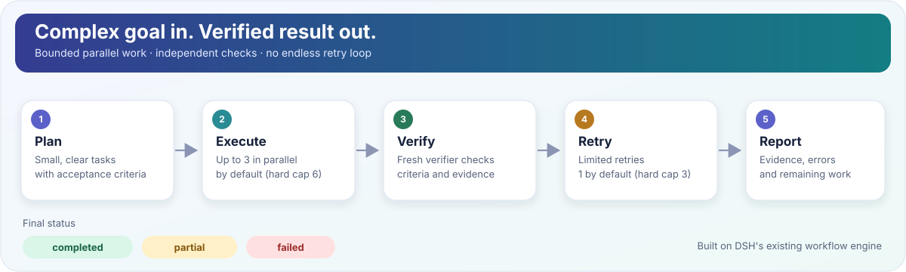

# Grok Workflow for DSH

<p align="center">
  <strong>Every message meets the front desk; the work that needs it runs plan, parallel execution, independent checks, honest result.</strong>
  <br />
  <a href="README.md">English</a> · <a href="README.zh-CN.md">简体中文</a>
</p>

<p align="center">
  <a href="https://github.com/free6589/dsh-grok-workflow/actions/workflows/ci.yml"></a>
  
  
  <a href="LICENSE"></a>
</p>

**Grok Workflow for DSH** is an external plugin for [DeepSeek Harness (DSH)](https://github.com/deepseek-ai/deepseek-harness). It gives DSH a mandatory entry for user messages: a gate intercepts every user message and hands it to the front desk, which picks a tier and says which one. It also registers the `grok_workflow` tool that the model can call directly.

The per-session toggle itself is **off by default** (`grokDefault: off`): until you send `/grok` in a session, its messages pass through as ordinary chat. With the toggle on, the front desk decides per message — a greeting is answered from a template, a small question by one worker, and only an objective that needs the team runs the full workflow.

You do not write a workflow script. Install the plugin, restart your profile, and ask a question: a message the front desk sends to the **team** tier is planned, run, verified task by task against its acceptance criteria, and answered in the same turn.



## What you get

| Requirement | What this plugin does |
|---|---|
| **A front desk in front of every message** | An `agent/pre-step` gate claims each user message and the front desk picks a tier — `direct`, `quick`, `team` or `ask` — stating the tier and its reason on the answer's first line. The full plan→execute→verify workflow runs on the `team` tier; nothing falls back silently to ordinary direct answering. |
| **Opt-in per session, honest about it** | `grokDefault: off` means a session chats normally until `/grok` turns the workflow on for it; `/grok off` turns it back. A toggle that cannot be persisted is reported as a failure instead of being claimed. |
| **Per-role model choice** | `roles.planner`, `roles.worker`, `roles.verifier`, `roles.synthesizer` each carry their own model. |
| **Ordered fallback chains per role** | Up to 50 routes per role; a route-level failure advances that role's chain and the routes actually used are recorded in the report. |
| **Operable settings** | The exported `Config` *is* the DSH settings page: live values, unknown keys rejected with a suggestion, chains validated against the providers the runtime really has. |
| **Pluggable workflow shape** | `mode: 'triage'` (default) keeps the front desk; `mode: 'full'` restores the older rule where every claimed message runs the team. |

## Install in one command

**Before you start:** DSH **`>=0.2.1-rc.2 <0.3.0`** and Node.js **22 or newer** are required. That is the range the package declares in `engines.dsh`, and it is the only requirement DSH's loader evaluates; prereleases of `0.2.x` are included. Your DSH profile must include the workflow and subagent services (the standard base/headless bundles provide them).

If you do not have a profile yet, create it from the headless template **before** installing the plugin:

```sh
dsh --profile grok-workflow-dev --from-default-profile headless --dump-config
```

Then install the plugin:

```sh
dsh plugin --profile grok-workflow-dev add github:free6589/dsh-grok-workflow#v0.11.13
```

> `#v0.11.13` is the current release. Pin the tag you actually want; omitting it follows `main`, which is not a release. Do not run `--from-default-profile` after `plugin add`: it replaces the profile and removes the plugin you just installed.

Then restart the profile so DSH loads the new plugin:

```sh
dsh --profile grok-workflow-dev
```

## Enable and verify

The bundle row is added by `dsh plugin add`. After restarting, confirm it is composed:

```sh
dsh --profile grok-workflow-dev --dump-config | grep -A4 'grok-workflow'
```

A healthy row includes `id: grok-workflow` and `name: dsh-grok-workflow`. At startup the plugin also logs one diagnostics line about its settings surface — for example `settings surface: page auto-generated for "grok-workflow" (9 field(s), applies live, …)`.

**Composed is not activated.** The plugin injects `workflowEngine`, and the Web app ships its workflow provider disabled, so on `dsh web` the row above is necessary but not sufficient:

```yaml
# <profile>/cordis.patch.yml
- id: workflow-ptc
  config:
    provider: spawn
  disabled: false
```

Four checks prove it is really active: the startup log has no `pending (waiting for service: workflowEngine)` line, `POST /api/settings/describe` lists the `grok-workflow` namespace, the Plugins page shows a **Grok workflow** card, and a real session's tool list contains `grok_workflow`. The full procedure — including how to move a running instance onto a new build, and which step needs your authorisation — is in [`docs/LOCAL-TESTING.md`](docs/LOCAL-TESTING.md#activate-in-an-existing-live-profile--needs-the-operators-authorisation).

The **Grok workflow** card opens the settings page: eight scalar settings, the five role chains (up to 50 routes each), and the structural keys shown read-only with the reason. Invalid input is refused before it reaches the Host, and a save applies to the next message.


## Try it

After DSH starts, just ask something:

> Inspect this repository, find two independent issues, verify each finding against the current files, and summarize what remains uncertain. Do not modify files.

Once the session's toggle is on (`/grok`; `grokDefault` is `off`), the gate claims that message whether or not the model would have called the tool. With the
default `mode: 'triage'` the front desk decides first: a long objective like the one above runs the
**team** tier and ends with a short status line (`Grok workflow: COMPLETED`, `PARTIAL` or `FAILED`)
plus the verified tasks, failures and uncertainties, while "what is today's date" takes the **quick**
tier and "hello" the **direct** tier — both stating their tier and reason in the first line. Set
`mode: 'full'` for the older behaviour (everything runs the team).

## How it works

The workflow exists to avoid treating an agent's “done” message as proof that the task is complete.

| Step | What happens |
|---|---|
| **1. Plan** | Break the goal into small tasks with clear acceptance criteria (and, when known, the paths each task writes). |
| **2. Execute** | Run independent tasks in parallel — default 3 at a time — with overlapping write paths serialized. |
| **3. Verify** | A fresh verifier checks every task against its criteria and requires evidence for each one. |
| **4. Retry** | A failed verification gets a bounded second chance, never an endless loop. |
| **5. Report** | Return a validated result: verified tasks, evidence, failures with a category, uncertainties. |

### Understand the final status

- **`completed`** — all planned tasks passed verification and no planning fallback was needed.
- **`partial`** — some useful work passed, but something remains incomplete or uncertain.
- **`failed`** — no task was verified, or the run failed before a usable report.

## Mandatory entry: what changes for you

- The gate is **always installed** in `0.10.0` (the former `enforceGate` switch was removed) and inspects every *user* message. Whether a message is *worked on* is a second switch: the per-session toggle, whose config default `grokDefault` is `off` — until `/grok` turns it on for that session, a message passes through to the model as ordinary chat (`reason: mode-off`). Messages from other sources — user-question replies, team messages, webhooks, schedules, subagent prompts — are never claimed, and an empty batch passes through.
- The answer arrives **inside the same turn**. `in-turn` is the only delivery strategy in `0.10.0` — it is the one that survives a one-shot process, and the former `relay`/`append` options were removed.
- A message the plugin will not run is **refused out loud** with the reason (empty message, or an objective over 32,000 characters). Nothing is executed and nothing is retried automatically.
- Delivery is recorded per message: the same batch dispatched twice does not start a second run, and each agent's waiting queue is bounded by `maxQueuedMessages`.
- To keep only the `grok_workflow` tool and skip interception entirely, leave `grokDefault` at `off` and never run `/grok on`. A deployment that must never degrade silently gets a warning (not a silent pass) when this runtime exposes no `agent/pre-step` hook; `0.10.0` has no `gateRequired` key left to promote that to a load error.

### Objective length limit

The workflow objective limit is **32,000 characters**, measured on the user message itself. The whole message is carried into the objective; it is never shortened to fit.

| Message length | What happens |
|---|---|
| 1–4,000 characters | Accepted (unchanged from earlier releases). |
| 4,001–32,000 characters | Accepted; the entire message is kept as the objective. At exactly 32,000 characters the `Current request:` label is dropped instead of trimming the message, and no conversation history is attached. |
| 32,001 characters or more | Refused out loud with `the message is longer than the 32000-character workflow objective limit`; no run starts. |

Other limits are unchanged: each task field (`objective`, `expectedOutput`, `context`) is still capped at `4000` characters, and the aggregate serialized task budget stays at `48,000` characters. History is fixed in `0.10.0` (`historyTurns=20` / `historyChars=20000`), the run deadline defaults to 60 minutes and is configurable (`timeoutMs`, `0` = unlimited), and each role chain holds up to `50` backup routes. A larger objective therefore has to be decomposed into several tasks rather than widening one task field or one deadline.

If planning fails, the fallback plan splits the whole objective into contiguous segments that each fit the 4,000-character task-text budget. Concatenating the segments reproduces the objective verbatim, so the fallback is **not** rejected a second time and no character is lost. The run reports `partial` with `planning.source: "fallback"` and the planner error.

## The front desk: four tiers, always stated (t52)

Every user message passes a **front desk** first, and the answer always says which tier it took and
why — the plugin may be cheap, but it may not be quiet about it:

| Tier | What runs | Cost |
|---|---|---|
| `直答档` (direct) | small talk answered from a template | no model call |
| `快手档` (quick) | one worker, one pass | one call (a structured retry if the first returns nothing) |
| `团队档` (team) | the full workflow, with a greeting and the progress board | the normal run |
| `确认档` (ask) | it asks `这个要动用团队吗？可回复：简单 / 团队` and remembers your answer | no model call |

You can always force the team by saying `用团队` / "use the team". The wording follows the language
of your message, not the interface language. `mode: 'full'` restores the older rule (every message
runs the team, no tier line, no greeting).

Questions are recognised as **shapes**, not from a word list — `A不A` / `A没A` (`多不多`, `有没有`), a `还是`
choice (`yarn 还是 pnpm`) and `谁` (`被谁占了`) — with the statement boundaries pinned (`他还是走了`,
`他问是谁`), so "a question never gets the template" holds for the shapes the rules recognise.
Two honest limits of the confirm tier: the pending question and its answer live in **plugin memory
for ten minutes** and are consumed when used, so a plugin reload or a longer pause forgets them; the
next "简单" / "团队" then says so (`档位：直答档 — 上一轮没有待回答的分流问题…`) instead of guessing what
it was answering. And the front desk answers a *pointer* with no object ("改一下那个") by asking,
while a pointer that carries a path, an error code or a snippet is taken as work and dispatched.

## Models per role and fallback chains

Give each role its own ordered chain. A route is `{ provider, model }`, and a bare model id is accepted as shorthand:

```yaml
- id: grok-workflow
  config:
    roles:
      planner: [{ provider: my-provider, model: strong-planner }]
      worker:
        - { provider: my-provider, model: fast-worker }
        - { provider: my-provider, model: backup-worker }
      verifier: [{ provider: my-provider, model: strict-verifier }]
      synthesizer: []          # empty = inherit the parent route
    synthesis: layered        # or: model (requires a synthesizer route); layered keeps the verified report the only source of fact
```

- **Route failures advance the chain**: `rate-limit`, `server-error`, `connection`, `timeout`, `model-unavailable`, `format-error`, `agent-start-failed`.
- **Content failures never do**: `task-failed` and `verification-failed` are retried on the same route, because another model would be looking at the same evidence.
- A chain that runs out reports `worker failed on every route: [class] reason` on that task; it is never silently reported as success.
- Configuration is validated at load: more than 50 routes in one chain, duplicate routes in one chain, an empty or over-long model id, or `synthesis: model` without a synthesizer route are all refused with a reason.
- The routes actually used are in the report (`routing`) and in the answer, so “configured but not in effect” cannot look like “working”.

## What a failure tells you

Every failure carries a `class` (what happened) and a `category` (who has to fix it):

| `category` | Meaning | Typical `class` values |
|---|---|---|
| `infrastructure` | The provider or transport failed; the work was not judged. | `rate-limit`, `server-error`, `connection`, `timeout`, `model-unavailable`, `format-error`, `agent-start-failed` |
| `quality` | The work ran and did not pass. | `task-failed`, `verification-failed` |
| `configuration` | The run could not proceed as configured. | `budget-exhausted`, setup errors, run-level cancellation, an unvalidatable report |
| `cancelled` | You (or the host) stopped it. | deliberate stop, plugin unload |
| `unknown` | Not classified — the plugin does not guess. | anything unmatched |

The rendered answer adds a `Failures: 1 infrastructure, 1 quality` line, so a provider outage is not read as poorly done work.

## Configuration reference

Configuration belongs to the profile's `cordis.patch.yml` (or a `--patch` overlay), under the bundle row. The surface is exactly nine keys (`timeoutMs` joined in `0.11.0`); anything else is rejected at load, so a stale patch fails loudly instead of looking like a setting that does nothing:

```yaml
- id: grok-workflow
  config:
    toolName: grok
    mode: triage
    grokDefault: 'on'
    synthesis: layered
    maxConcurrency: 10
    maxTasks: 10
    roles:
      planner:
        - provider: deepseek-official
          model: deepseek-flash
```

| Key | Default | Hard limit | Meaning |
|---|---:|---:|---|
| `toolName` | `grok_workflow` | pattern `^[a-z][a-z0-9_]{1,40}$` | Model-facing tool name (fixed at registration) |
| `mode` | `triage` | `triage` \| `full` | `triage`: the front desk picks a tier and says so (the settings page shows it as `auto`). `full`: every message runs the team |
| `grokDefault` | `off` | `on` \| `off` | Session default when no `/grok` record exists. `off` leaves ordinary chat alone; `on` claims every user message |
| `roles` | empty chains | ≤50 routes each | `{ planner, worker, verifier, synthesizer, supervisor }` ordered chains. The supervisor runs after verification and can only fail a task, never pass one |
| `synthesis` | `layered` | `layered` \| `model` | `layered` keeps the verified report the only source of fact; `model` adds one model-written summary |
| `maxConcurrency` | `10` | `100` | Child agents in flight per run |
| `maxTasks` | `10` | `100` | Maximum caller or planner tasks |
| `timeoutMs` | `3600000` (60 min) | any non-negative integer (`0` = unlimited) | Run deadline in milliseconds. `0` arms no timer; a value above `2147483647` (the largest `setTimeout` delay) is treated as unlimited internally while the report records the configured number |
| `configVersion` | `1` | `1` | Configuration surface version |

Everything else is fixed inside the plugin and no longer accepted: `maxRetries=1`, `maxActiveRuns=2` per session and `maxActiveRunsTotal=8` per process, `historyTurns=20` / `historyChars=20000`, `maxQueuedMessages=4`, `recordLimit=256`, `answerStrategy=in-turn`, `triageClassifier=rules`, `triageAsk`, `triageModel` unset, `triageFollowupAsFast`, `instantReceipt`, `humanSummary`, `showDiagnostics=false`, `recordRuns`, `showProgress`, `switchOn=[]` (built-in policy), `subagentProvider` unset, and the gate (`enforceGate`/`gateRequired`/`gateScope`/`gatePreset`) is always on.

**Migration from ≤0.9.4:** delete those keys from your patch. A patch that still carries one is rejected as an unknown key, and there is no replacement for a removed value — the fixed value above applies.

### The settings page

Because the plugin exports its `Config`, DSH projects it into the standard settings surface automatically: the fields on that page are the fields this plugin reads — there is no second, decorative source of truth. Edits are live: an edit reaches the next message, and an invalid edit is refused with its reason while delivery keeps the last valid snapshot.

The page shows four things and nothing else: the on/off switch, the mode (`auto`/`full`), the five role chains as "channel → model" dropdowns fed by the runtime's declared models, and the three numbers (jobs at once, splits per job, run deadline). No per-field explanations, no read-only area, no diagnostics panel.

### Disable and uninstall

```yaml
- id: grok-workflow
  disabled: true
```

```sh
dsh plugin --profile grok-workflow-dev remove dsh-grok-workflow
```

When disabled or absent, neither the tool nor the gate is registered; normal DSH sessions are unaffected.

## Parallel work and write paths

Parallel tasks share the session's working directory. A task may declare the paths it writes:

```json
{ "id": "docs", "title": "Update docs", "writesPaths": ["docs/knowledge"] }
```

Tasks whose declared paths overlap run one after another; everything else keeps running in parallel, and `maxConcurrency` stays an upper bound. `[]` means “this task writes nothing”. Declaring nothing means “unknown”, which is treated conservatively (it does not run beside anything that declares paths). Overlap is decided lexically — `.`, `..`, separators and case are normalized, and prefixes are compared per segment, so `src` covers `src/a.ts` while `src/a` does not cover `src/ab`.

This is a mitigation, not a sandbox: the verifier is still an independent check, not a formal proof, and a task that ignores its own declaration is beyond what the plugin can see. For write-heavy work you can also set `maxConcurrency: 1`.

Whether a real planner model fills `writesPaths` is **not settled**: in the one measured
sample (an objective that explicitly asked for per-task write paths) the planner declared
nothing, and the task reached the worker with `writesPaths: null`. When a plan declares
nothing, scheduling behaves exactly as it did before this feature. Treat the mitigation as
automatic only for plans whose tasks declare paths.

## Sensible limits by default

| Setting | Default | Hard maximum |
|---|---:|---:|
| Parallel workers | 3 | 6 |
| Retries per task | 1 | 3 |
| Tasks per run | 6 | 12 |
| Active workflow runs | 2 | 4 |
| Routes per role chain | 0 (inherit) | 50 |
| Ledger entries per run | 64 | 256 |

The plugin reuses DSH's workflow engine and subagents. It does not replace DSH's agent loop or bypass its approval and tool policies.

## If something does not work

- **The tool does not appear:** restart the profile and confirm it contains the workflow engine and a subagent provider.
- **Every answer looks like a workflow now:** that is the always-on gate plus `grokDefault: on`. Send `/grok off` to turn the toggle off for one session, or leave `grokDefault` at `off` to require an opt-in.
- **A message is refused instead of answered:** the reason is printed (empty message or an objective over 32,000 characters). Nothing was executed and nothing will be retried automatically.
- **A key is rejected at load:** the message names the closest accepted key. Silent ignoring is not offered on purpose.
- **Your DSH version differs:** the package declares `engines.dsh: ">=0.2.1-rc.2 <0.3.0"`, and that range decides whether the bundle loads. DSH evaluates it with prereleases included (that is what lets `0.2.2-rc.3` load at all), so a `0.2.x` prerelease is admitted and `0.3.0` and above are refused — a `0.3.0` *prerelease* still satisfies `<0.3.0` and therefore loads. Behavior is verified on `0.2.1-rc.2`; on `0.2.2-rc.3` the bundle installs, activates (its row is no longer `pending`) and serves its settings namespace.
- **You want to understand the design:** see [Architecture](docs/ARCHITECTURE.md), the [design knowledge base](docs/knowledge/WORKFLOW-DESIGN.md) and the [acceptance checklist](docs/ACCEPTANCE.md).
- **You found a bug:** [Open an issue](https://github.com/free6589/dsh-grok-workflow/issues).

## Versions and release notes

The package version in this repository is `0.11.13`. Install or roll back to an exact release with a tag suffix:

```sh
dsh plugin --profile grok-workflow-dev add github:free6589/dsh-grok-workflow#v0.11.13
```

Use only a tag that exists on GitHub. Published: `v0.1.0`, `v0.2.0`, `v0.2.1`, `v0.2.2`, `v0.2.3`, `v0.2.4`, `v0.2.5`, `v0.2.6`, `v0.2.7`, `v0.3.0`, `v0.4.0`, `v0.5.0`, `v0.5.1`, `v0.6.0`, `v0.7.0`, `v0.8.0`, `v0.9.0`, `v0.9.1`, `v0.9.2`, `v0.9.3`, `v0.9.4`, `v0.10.0`, `v0.10.1`, `v0.10.2`, `v0.11.0`, `v0.11.1`, `v0.11.2`, `v0.11.3`, `v0.11.4`, `v0.11.5`, `v0.11.6`, `v0.11.7`, `v0.11.8`, `v0.11.9`, `v0.11.10`, `v0.11.11`, `v0.11.12` and `v0.11.13`. The unpinned command follows `main` and does not pin a release. `v0.2.0-rc.1` also exists on GitHub but is not a release: it predates the release workflow and its `package.json` still declares `0.1.0`. See the [changelog](CHANGELOG.md) and the [release guide](docs/RELEASING.md) for the versioning and rollback rules.

## Testing and development

```sh
npm ci
npm run ci
```

`npm run ci` runs typecheck, lint, build and **1022 deterministic tests across 57 files**; no online model is needed. The suite covers the generated workflow, the real PTC engine contract, the gate and delivery paths, routing and fallback chains, failure classification, the configuration surface, write-path isolation and a reliability set (cancellation, deadlines, concurrency, duplicates, recursion, context bounds, redaction, unload/reload). Model-backed end-to-end checks are separate scripts and are recorded in [the validation log](docs/knowledge/VALIDATION.md); the headless one-shot delivery check is `scripts/e2e-headless-in-turn.sh`.

## Security and compatibility

- Verified with DSH **`0.2.1-rc.2`** (full runs) and **`0.2.2-rc.3`** (install, activation, settings projection) and Node.js **22 or newer**. The package declares its DSH requirement as the range **`engines.dsh: ">=0.2.1-rc.2 <0.3.0"`** — an own `engines.dsh` decides alone, so this range (not the peer ranges) is what admits a runtime and what makes a later release refuse to load instead of failing at run time. The peer packages the build is tested against stay pinned exactly (`@deepseek-ai/cordis` uses a compatible `~4.0.5` range). This is an external DSH bundle and does not modify DSH core.
- It does not bypass DSH approvals, sandbox policy or tool policy. Child agents cannot recursively invoke `grok_workflow`; their other tools remain subject to DSH's own policy.
- Child agents inherit the parent session's available tools and permissions. There is no read-only capability mode; the verifier prompt asks it not to modify files, but that is not a hard sandbox guarantee.
- Redaction is best-effort and lives in one place (`src/redact.ts`; the generated workflow script mirrors the same rule table for prompts). It covers PEM and PGP `PRIVATE KEY` blocks, JWT, `sk-`/`ghp_`/`github_pat_`/`glpat-`/`npm_`/`xox*`/`AKIA`/`ASIA`/`AIza`/`ya29.`/Telegram bot tokens, `Bearer` and `Basic` authorization, `Cookie`/`Set-Cookie` headers (also when written inside a quoted shell argument), URL userinfo, signed-URL query parameters (`sig`, `X-Amz-Signature`, `X-Goog-Signature`, `auth`, `token`), and secret-named assignments in env, JSON and header form. No shape list is complete: do not put credentials in objectives, task text or logs, and treat a report as no proof that a child agent never touched a secret.
- Parallel tasks share the session working directory; declare `writesPaths` or use `maxConcurrency: 1` for write-heavy work.
- No npm package is published; install from this GitHub repository.

## Known limitations

- The confirm tier's memory lives in plugin process memory (ten minutes, consumed on use): after a
  reload or a longer pause a bare "simple / team" is told there is no pending question, so put the
  task and the choice in one message (DECISIONS D-024).
- The greeting arrives with the final answer; during the run only the progress board is visible
  (`in-turn` admits one plugin message per turn).
- The direct tier's wording is a template with no model text in it. That is the design, not a
  downgrade.
- **Not measured with a real settings GUI:** the auto-generated page is proven to exist and to be identified by the runtime, but clicking through it in a live Web GUI, and editing a `roles` array on that page, is NOT_RUN (NR-1/NR-7/NR-8 in the [design ledger](docs/knowledge/WORKFLOW-DESIGN.md)).
- **Planner fill-rate for `writesPaths` is not established:** in the single measured sample (with the objective explicitly asking for declarations) the planner declared nothing, so nothing was serialized. Only callers that declare their own paths get the mitigation automatically today.
- **Real-provider failure texts are not exhaustively measured** (NR-5/NR-6): classification is a whitelist, and anything unmatched is reported as `unknown` rather than guessed.
- No pause/resume, journaling or cross-process resume; cancellation is cooperative.
- No background job mode; calls run in the foreground.
- No task dependency graph; tasks are independent by design, and only write-path overlap is serialized.
- No custom Web UI; results use DSH's generic tool card and a chain editor is Phase 9 work.
- See [known architecture limits](docs/ARCHITECTURE.md#known-architecture-limits-mvp) for the full list.

## Documentation

- [Local installation and troubleshooting](docs/LOCAL-TESTING.md)
- [Architecture](docs/ARCHITECTURE.md)
- [Acceptance checklist](docs/ACCEPTANCE.md)
- [Design knowledge base](docs/knowledge/WORKFLOW-DESIGN.md)
- [Roadmap](docs/knowledge/WORKFLOW-ROADMAP.md)
- [Issue watcher (optional)](docs/ISSUE-WATCHER.md)
- [Changelog](CHANGELOG.md)
- [Versioning and release guide](docs/RELEASING.md)
- [Project state and handoff notes](docs/knowledge/STATE.md)

## License

[MIT](LICENSE)
