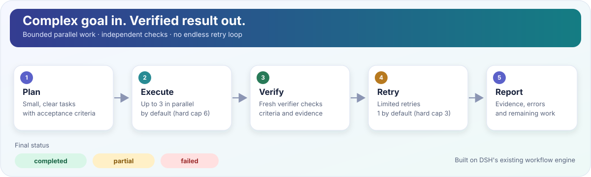

# Grok Workflow for DSH

<p align="center">
  <strong>Give DSH a goal. Get a plan, parallel work, independent checks, and an honest result.</strong>
  <br />
  <a href="README.md">English</a> · <a href="README.zh-CN.md">简体中文</a>
</p>

<p align="center">
  <a href="https://github.com/free6589/dsh-grok-workflow/actions/workflows/ci.yml"></a>
  
  
  <a href="LICENSE"></a>
</p>

**Grok Workflow for DSH** is a plugin for [DeepSeek Harness (DSH)](https://github.com/deepseek-ai/deepseek-harness). It adds one tool, `grok_workflow`, that helps DSH handle a complex goal in clear, checkable steps.

You do not need to write a workflow script. Install the plugin, restart your DSH profile, then ask your model to use `grok_workflow`.



## Install in one command

**Before you start:** DSH **`0.2.1-rc.2`** and Node.js **22 or newer** are required. Your DSH profile must include the workflow and subagent services (the standard base/headless bundles provide them).

Run this in your terminal:

```sh
dsh plugin --profile grok-workflow-dev add github:free6589/dsh-grok-workflow
```

This installs the plugin from GitHub and adds it to the profile. If your profile has a different name, replace `grok-workflow-dev` with that name. If you do not have a profile yet, create one from the headless template first:

```sh
dsh --profile grok-workflow-dev --from-default-profile headless --dump-config
```

Then restart the profile so DSH loads the new plugin:

```sh
dsh --profile grok-workflow-dev
```

Check your versions with `dsh --version` and `node --version`. This project is **not published to npm**; the install command above uses GitHub.

## Try it

After DSH starts, ask your model something like:

> Use `grok_workflow` to inspect this repository, find two independent issues, verify each finding against the current files, and summarize what remains uncertain. Do not modify files.

That's it. The model can create a plan automatically. For most first-time users, you do not need to configure anything else.

## How it works

The workflow is designed to avoid treating an agent's “done” message as proof that the task is complete.

| Step | What happens |
|---|---|
| **1. Plan** | Break the goal into small tasks with clear acceptance criteria. |
| **2. Execute** | Run independent tasks in parallel, with a default of 3 workers. |
| **3. Verify** | A fresh verifier checks every task against its criteria and evidence. |
| **4. Retry** | Give failed verification a limited second chance, not an endless loop. |
| **5. Report** | Return a clear result, evidence, errors, and unfinished work. |

### Understand the final status

- **`completed`** — all planned tasks passed verification and no planning fallback was needed.
- **`partial`** — some useful work passed, but something remains incomplete or uncertain.
- **`failed`** — no task was verified successfully, or the run failed before a usable report.

The report includes task-by-task status, evidence, attempts, errors, and uncertainties, so you can see what the workflow actually verified.

## Sensible limits by default

| Setting | Default | Hard maximum |
|---|---:|---:|
| Parallel workers | 3 | 6 |
| Retries per task | 1 | 3 |
| Tasks per run | 6 | 12 |
| Active workflow calls | 2 | 4 |

The plugin reuses DSH's workflow engine and subagents. It does not replace DSH's agent loop or bypass its approval and tool policies.

**Important limitation:** parallel tasks share the DSH session's working directory in this MVP. For tasks that edit files, give each task a non-overlapping file scope or set `maxConcurrency: 1`. The verifier is an independent check, not a mathematical proof of correctness.

## If something does not work

- **The tool does not appear:** restart the profile and confirm it contains the workflow engine and a subagent provider.
- **Your DSH version differs:** this version is verified only with DSH `0.2.1-rc.2`.
- **You need to change concurrency or retries:** see [Configuration and troubleshooting](docs/LOCAL-TESTING.md).
- **You want to understand the design:** see [Architecture](docs/ARCHITECTURE.md) and the [acceptance checklist](docs/ACCEPTANCE.md).
- **You found a bug:** [Open an issue](https://github.com/free6589/dsh-grok-workflow/issues).

## For developers

Clone the repository and run:

```sh
npm ci
npm run ci
```

The automated suite checks the generated workflow, bounds, retries, redaction, lifecycle, and real DSH Loader composition. It does not call an online model. Real DSH/model acceptance checks are recorded separately in [the validation log](docs/knowledge/VALIDATION.md).

## Documentation

- [Local installation and troubleshooting](docs/LOCAL-TESTING.md)
- [Architecture](docs/ARCHITECTURE.md)
- [Acceptance checklist](docs/ACCEPTANCE.md)
- [Issue watcher (optional)](docs/ISSUE-WATCHER.md)
- [Project state and handoff notes](docs/knowledge/STATE.md)

## License

[MIT](LICENSE)
