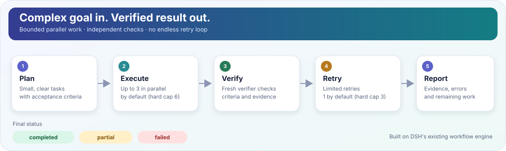

# Grok Workflow for DSH

<p align="center">
  <strong>每条消息都先过前台；该上工作流的那些，才跑规划、并行执行、独立验证、如实汇报。</strong>
  <br />
  <a href="README.md">English</a> · <a href="README.zh-CN.md">简体中文</a>
</p>

<p align="center">
  <a href="https://github.com/free6589/dsh-grok-workflow/actions/workflows/ci.yml"></a>
  
  
  <a href="LICENSE"></a>
</p>

**Grok Workflow for DSH** 是 [DeepSeek Harness (DSH)](https://github.com/deepseek-ai/deepseek-harness) 的外部插件。它给 DSH 的用户消息加了一道强制入口：闸门拦截每条用户消息并交给前台，由前台选定档位、并写明选的是哪一档。它也注册模型可直接调用的 `grok_workflow` 工具。

会话内的开关本身**默认是关的**（`grokDefault: off`）：在某一轮里发过 `/grok` 之前，这个会话的消息按普通聊天放行。开关打开后，前台逐条判定——寒暄用模板回、小问题派一个工人、只有确实需要团队的目标才跑完整工作流。

你不需要写工作流脚本。安装插件、重启 profile、直接提问即可：被前台派到**团队档**的消息会做规划、执行任务、逐条对照验收标准验证，并在同一轮内给出答案。



## 你会得到什么

| 需求 | 本插件的做法 |
|---|---|
| **每条消息前面都有一张前台** | `agent/pre-step` 闸门认领每条用户消息，前台选一档——`直答档`、`快手档`、`团队档` 或 `确认档`——并在答案第一行写明档位与理由。完整「规划→执行→验证」工作流只在**团队档**运行；不会静默退回普通直接回答。 |
| **按会话开启，且如实相告** | `grokDefault: off` 意味着一个会话在 `/grok` 开启之前就是普通聊天；`/grok off` 再关掉。写不进去的开关会被报成失败，而不是被当成已生效。 |
| **按角色选模型** | `roles.planner`、`roles.worker`、`roles.verifier`、`roles.synthesizer` 各带自己的模型。 |
| **每角色有序备用链** | 每个角色最多 50 条路由；路由级失败会推进该角色的链，实际用到的路由会写进报告。 |
| **可操作的设置** | 导出的 `Config` **就是** DSH 设置页：字段是活值、未知键被拒绝并给出建议、链会对照运行时真实拥有的 provider 校验。 |
| **工作流形状可选** | `mode: 'triage'`（默认）保留前台分流；`mode: 'full'` 恢复旧规则：每条被认领的消息都跑团队。 |

## 一条命令安装

**开始之前：**需要 DSH **`>=0.2.1-rc.2 <0.3.0`** 与 Node.js **22 或更高版本**。这就是包在 `engines.dsh` 里声明的区间，也是 DSH loader 唯一评估的要求；`0.2.x` 的预发布版本包含在内。你的 profile 必须包含工作流与子代理服务（标准 base/headless 套件已提供）。

如果还没有 profile，请在安装插件**之前**先用 headless 模板创建：

```sh
dsh --profile grok-workflow-dev --from-default-profile headless --dump-config
```

然后安装插件：

```sh
dsh plugin --profile grok-workflow-dev add github:free6589/dsh-grok-workflow#v0.11.7
```

> `#v0.11.7` 是当前发布版本。请固定你真正想要的标签；省略标签会跟随 `main`，那不是发布版本。不要在 `plugin add` 之后再运行 `--from-default-profile`：它会重建 profile 并移除你刚装好的插件。

最后重启 profile，让 DSH 加载新插件：

```sh
dsh --profile grok-workflow-dev
```

## 启用与自检

bundle 行由 `dsh plugin add` 写入。重启后确认它确实被组合进去：

```sh
dsh --profile grok-workflow-dev --dump-config | grep -A4 'grok-workflow'
```

健康的行包含 `id: grok-workflow` 与 `name: dsh-grok-workflow`。启动时插件还会打印一行设置面诊断，例如 `settings surface: page auto-generated for "grok-workflow" (9 field(s), …)`。

**进了组合图 ≠ 被激活。** 插件注入 `workflowEngine`，而 Web 应用层默认禁用了工作流 provider，所以在 `dsh web` 上上面那行必要但不充分：

```yaml
# <profile>/cordis.patch.yml
- id: workflow-ptc
  config:
    provider: spawn
  disabled: false
```

四条校验才能证明它真的激活了：启动日志没有 `pending (waiting for service: workflowEngine)`、`POST /api/settings/describe` 里出现 `grok-workflow` 命名空间、插件页出现 **Grok workflow** 卡片、真实会话的工具列表里有 `grok_workflow`。完整流程（包括如何把"在跑的实例"迁到新构建、哪一步需要你授权）见 [`docs/LOCAL-TESTING.md`](docs/LOCAL-TESTING.md#activate-in-an-existing-live-profile--needs-the-operators-authorisation)。

**Grok workflow** 卡片就是设置页：八个标量设置、五条角色链（每角色最多 50 条）、以及显示为只读并给出原因的结构性字段；非法输入在到达 Host 之前就被拦下，保存后对下一条消息生效。


## 试一试

DSH 启动后，直接提问即可：

> 检查这个仓库，找出两个互相独立的问题，逐条对照当前文件验证每个发现，并总结还有哪些不确定的地方。不要修改文件。

在会话开关打开后（发 `/grok`；`grokDefault` 默认是 `off`），无论模型是否会调用工具，闸门都会认领这条消息。默认 `mode: 'triage'` 下先过前台：上面的长目标会走**团队档**并附一行状态（`Grok workflow: COMPLETED`、`PARTIAL` 或 `FAILED`）与已验证的任务、失败项、不确定项；而一句“今天几号”会走**快手档**、一句“你好”走**直答档**，答案第一行都写明档位与理由。想要旧行为（每条都跑团队），把 `mode` 设成 `full`。

## 工作方式

工作流存在的目的，是不把“做完了”这句话当成任务完成的证据。

| 步骤 | 发生什么 |
|---|---|
| **1. 规划** | 把目标拆成带明确验收标准的小任务（已知时还会给出每个任务写入的路径）。 |
| **2. 执行** | 独立任务并行执行——默认同时 3 个——写入路径重叠的任务串行。 |
| **3. 验证** | 全新的验证者对照验收标准逐项检查，并要求每条标准都有证据。 |
| **4. 重试** | 验证失败只给有限的一次机会，不会无限循环。 |
| **5. 汇报** | 返回经过校验的结果：已验证任务、证据、带归类的失败与不确定项。 |

### 理解最终状态

- **`completed`** —— 全部计划任务通过验证，且没有退回降级的规划。
- **`partial`** —— 有实质工作通过，但仍有未完成或不确定的部分。
- **`failed`** —— 没有任何任务通过验证，或运行在产出可用报告前失败。

## 强制入口：对你意味着什么

- `0.10.0` 起闸门**恒开**（原先的 `enforceGate` 开关已删除），会检查每一条**用户**消息。但“是否真的动手做”是第二个开关：会话级开关的配置默认值 `grokDefault` 是 `off` —— 在那个会话里发过 `/grok` 之前，消息按普通聊天交给模型（`reason: mode-off`）。其它来源的消息——用户问题回复、团队消息、webhook、定时任务、子代理提示词——从不认领；空批直接放行。
- 答案在**同一轮内**到达。`0.10.0` 只剩 `in-turn` 一种投递方式——它是唯一能在一次性进程中存活的策略，原来的 `relay`、`append` 已删除。
- 插件不会执行的消息会**明确拒绝**并给出原因（消息为空，或目标超过 32,000 字符）。不会执行任何工作，也不会自动重试。
- 交付按消息记录：同一批消息被派发两次不会启动第二次运行；每个 agent 的等待队列由 `maxQueuedMessages` 封顶。
- 想只保留 `grok_workflow` 工具、完全不拦截，就让 `grokDefault` 保持 `off` 且不要发 `/grok on`。要求“绝不静默降级”的部署会看到“运行时没有 `agent/pre-step` 钩子”的警告（不是静默放行）；`0.10.0` 已没有 `gateRequired` 键可以把它升成载入错误。

### 目标长度上限

工作流目标上限为 **32,000 字符**，按用户消息本身计算；整条消息原样带入目标，绝不为了塞进上限而截短。

| 消息长度 | 行为 |
|---|---|
| 1–4,000 字符 | 接受（与旧版本一致）。 |
| 4,001–32,000 字符 | 接受；整条消息原样成为目标。恰好 32,000 字符时会丢弃 `Current request:` 标签而不是裁剪消息，也不再附带历史。 |
| 32,001 字符及以上 | 明确拒绝，提示 `the message is longer than the 32000-character workflow objective limit`；不会启动任何运行。 |

其它限制保持不变：每个任务字段（`objective`、`expectedOutput`、`context`）仍各限 `4000` 字符，任务 JSON 合计仍限 `48,000` 字符。`0.10.0` 起历史固化（`historyTurns=20` / `historyChars=20000`）；运行时限默认 60 分钟且可配置（`timeoutMs`，`0` = 不限时）；每条角色链最多 `50` 条备用路由。因此更大的目标必须拆成多个任务，而不是放宽单个任务字段或时限。

规划失败时，fallback 计划会把整个目标切成若干连续分段，每段都不超过 4,000 字符的任务文本上限；分段按序拼接后与原始目标逐字一致，因此**不会**被二次拒绝，也不会丢失任何字符。运行以 `partial` 结束，并记录 `planning.source: "fallback"` 与规划错误。

## 前台：四档分流，条条写明（t52）

每条用户消息先过一个**前台**，回答的第一行永远写明走了哪一档、为什么——插件可以省钱，但不许闷着省：

| 档位 | 跑什么 | 花多少 |
|---|---|---|
| `直答档`（direct） | 闲聊用模板秒回 | 不花模型调用 |
| `快手档`（quick） | 派一个工人，一趟做完 | 一次调用（第一次没产出时重试一次结构化调用） |
| `团队档`（team） | 完整工作流，带开工迎宾与进度面板 | 正常的一次运行 |
| `确认档`（ask） | 反问 `这个要动用团队吗？可回复：简单 / 团队`，并记住你的回答 | 不花模型调用 |

任何一句 `用团队` / “use the team” 都能强制走团队档。档位措辞跟随**你消息的语言**，不跟随界面语言。
`mode: 'full'` 恢复旧的规则（每条消息都跑团队、没有档位行、没有迎宾语）。

判定的顺序就是它的正确性：`模式` → 待答/裸档位词 → 点名团队 → 寒暄 → 插件自述 → 模糊指向 →
长目标 → **多步（先…然后、序号、顿号列表、分号、`并+动词`）** → 团队计分 → **已识别的问句形态（至少快手档，绝不用模板）** → 短而惰性（模板） → 冲突反问 → 快手。带路径、错误码或代码片段的“这个报错”按派工处理，
不反问；只有**没有对象**的指向（“改一下那个”）才会被问回来。

**两条诚实的限制。** ① 确认档的问题与你的回答存在**插件内存里，10 分钟、用后即消**，所以插件重载或隔了
十分钟以上再回“简单 / 团队”，它会明说上一轮没有待回答的分流问题（`档位：直答档 — 上一轮没有待回答的
分流问题…`），而不是猜你在回答什么。② 迎宾语随最终回答一起到达，不是先到：`in-turn` 下一轮只允许一条
插件消息，所以运行期间你能看到的是进度面板。

## 按角色配置模型与备用链

给每个角色一条有序链。路由是 `{ provider, model }`，也接受裸模型 id 简写：

```yaml
- id: grok-workflow
  config:
    roles:
      planner: [{ provider: my-provider, model: strong-planner }]
      worker:
        - { provider: my-provider, model: fast-worker }
        - { provider: my-provider, model: backup-worker }
      verifier: [{ provider: my-provider, model: strict-verifier }]
      synthesizer: []          # 空 = 继承父级路由
    synthesis: layered        # 或 model（需要 synthesizer 路由）；layered 时核验报告仍是唯一事实来源
```

- **路由级失败推进备用链**：`rate-limit`、`server-error`、`connection`、`timeout`、`model-unavailable`、`format-error`、`agent-start-failed`。
- **内容类失败永不推进**：`task-failed` 与 `verification-failed` 会在同一路由上重试，因为换个模型看到的还是同样的证据。
- 链耗尽时该任务报 `worker failed on every route: [class] reason`，绝不会被静默报成成功。
- 配置在载入时即校验：同一链内超过 50 条路由、同一链内重复路由、模型为空或过长、`synthesis: model` 却没有 synthesizer 路由——都会带原因被拒绝。
- 实际用到的路由写在报告（`routing`）与答案里，因此“配了但没生效”不会看起来像“已经可用”。

## 失败告诉你什么

每个失败同时带 `class`（发生了什么）与 `category`（该谁修）：

| `category` | 含义 | 常见 `class` |
|---|---|---|
| `infrastructure` | provider 或传输层故障；工作本身没有被判定。 | `rate-limit`、`server-error`、`connection`、`timeout`、`model-unavailable`、`format-error`、`agent-start-failed` |
| `quality` | 工作执行了但没通过。 | `task-failed`、`verification-failed` |
| `configuration` | 运行无法按配置继续。 | `budget-exhausted`、setup 类错误、运行级取消、无法校验的报告 |
| `cancelled` | 你（或宿主）停掉了它。 | 主动停止、插件卸载 |
| `unknown` | 未归类——插件不猜。 | 其余未匹配项 |

渲染的答案会增加 `Failures: 1 infrastructure, 1 quality` 这样的行，因此 provider 故障不会被读成“活干得不好”。

## 配置参考

配置写在 profile 的 `cordis.patch.yml`（或 `--patch` 覆盖层）里，位于 bundle 行下。`0.10.0` 起配置面只有八个键，`0.11.0` 起为九个（新增 `timeoutMs`）；其它键在载入时直接被拒绝——旧补丁会明确报错，而不是变成"设了也不生效"：

```yaml
- id: grok-workflow
  config:
    toolName: grok
    mode: triage
    grokDefault: 'on'
    synthesis: layered
    maxConcurrency: 10
    maxTasks: 10
    roles:
      planner:
        - provider: deepseek-official
          model: deepseek-flash
```

| 键 | 默认值 | 硬上限 | 含义 |
|---|---:|---:|---|
| `toolName` | `grok_workflow` | 正则 `^[a-z][a-z0-9_]{1,40}$` | 面向模型的工具名（注册时固定） |
| `mode` | `triage` | `triage` \| `full` | `triage`：前台选一档并写明（设置页显示为 `auto`）。`full`：每条消息都跑团队 |
| `grokDefault` | `off` | `on` \| `off` | 会话没有 `/grok` 记录时的默认：`off` 不碰普通对话，`on` 认领每条用户消息 |
| `roles` | 空链 | 每个角色 ≤50 条 | `{ planner, worker, verifier, synthesizer, supervisor }` 有序链；监督在检查之后运行，只能判失败、不能判通过 |
| `synthesis` | `layered` | `layered` \| `model` | `layered` 让核验报告保持唯一事实来源；`model` 追加一次模型总结 |
| `maxConcurrency` | `10` | `100` | 每次运行的并行子代理数 |
| `maxTasks` | `10` | `100` | 调用方或规划器任务上限 |
| `timeoutMs` | `3600000`（60 分钟） | 任意非负整数（`0` = 不限时） | 运行时限（毫秒）。`0` 不设 timer；大于 `2147483647`（`setTimeout` 上限）的值在内部按不限时处理，报告里仍如实记录配置的数字 |
| `configVersion` | `1` | `1` | 配置面版本 |

其余一律固化在插件内部、不再接受：`maxRetries=1`、`maxActiveRuns=2`（每会话） / `maxActiveRunsTotal=8`（每进程）、`historyTurns=20` / `historyChars=20000`、`maxQueuedMessages=4`、`recordLimit=256`、`answerStrategy=in-turn`、`triageClassifier=rules`、`triageAsk`、`triageModel` 未设、`triageFollowupAsFast`、`instantReceipt`、`humanSummary`、`showDiagnostics=false`、`recordRuns`、`showProgress`、`switchOn=[]`（内置策略）、`subagentProvider` 未设，闸门（`enforceGate`/`gateRequired`/`gateScope`/`gatePreset`）恒开。

**从 ≤0.9.4 迁移：** 把这些键从补丁里删掉。还带着它们会被当未知键拒绝，而被删的值没有替代项——按上面的固定值生效。

### 设置页

由于插件导出了自己的 `Config`，DSH 会把它投影到标准设置面：页面上的字段就是插件读取的字段——不存在第二份装饰性的真相来源。编辑是活值：编辑对下一条消息生效，非法编辑会带原因被拒绝，而投递继续使用上一次合法快照。

页面只显示四样东西：总开关、模式（`auto`/`full`）、五条角色链（"通道 → 模型"双下拉，目录读运行时已声明的模型）、以及三个数字（同时干几件、一次拆几件、运行死线）。没有逐项用途说明，没有只读区，没有诊断面板。


### 停用与卸载

```yaml
- id: grok-workflow
  disabled: true
```

```sh
dsh plugin --profile grok-workflow-dev remove dsh-grok-workflow
```

停用或未安装时，工具与闸门都不会注册；普通 DSH 会话不受影响。

## 并行任务与写入路径

并行任务共享会话工作目录。任务可以声明自己写入的路径：

```json
{ "id": "docs", "title": "更新文档", "writesPaths": ["docs/knowledge"] }
```

声明路径重叠的任务依次执行，其余保持并行，`maxConcurrency` 仍是上限。`[]` 表示“这个任务不写文件”；什么都不声明表示“未知”，按保守方式处理（不与任何声明了路径的任务并行）。重叠判定是词法的：`.`、`..`、分隔符与大小写会被归一，前缀按段比较，因此 `src` 覆盖 `src/a.ts`，而 `src/a` 不覆盖 `src/ab`。

这是缓解措施，不是沙箱：验证者仍是独立检查而非形式证明，任务若违背自己的声明也超出插件可见范围。写入密集的工作还可以直接设 `maxConcurrency: 1`。

真实规划模型是否会填写 `writesPaths`，目前**没有结论**：唯一一次实测（目标里明确要求每个任务声明写入路径）中规划器没有声明，任务以 `writesPaths: null` 到达 worker。计划不声明时，调度行为与本功能之前完全一致。因此这项缓解目前只对“任务自己声明了路径”的计划自动生效。

## 默认的合理上限

| 设置 | 默认值 | 硬上限 |
|---|---:|---:|
| 并行 worker | 3 | 6 |
| 每任务重试 | 1 | 3 |
| 每次运行任务 | 6 | 12 |
| 并发工作流运行 | 2 | 4 |
| 每角色链路由数 | 0（继承） | 50 |
| 每次运行台账条数 | 64 | 256 |

插件复用 DSH 的工作流引擎与子代理，不替换 DSH 的 agent 循环，也不绕过其审批与工具策略。

## 出问题时

- **工具没出现：** 重启 profile，并确认它包含工作流引擎与子代理 provider。
- **现在每个回答都像工作流：** 这是恒开闸门叠加 `grokDefault: on` 的效果；发 `/grok off` 只关掉那个会话的开关，或者让 `grokDefault` 保持 `off`（要求显式开启）。
- **消息被拒绝而不是被回答：** 原因会被打印（消息为空，或目标超过 32,000 字符）。没有执行任何工作，也不会自动重试。
- **某个键在载入时被拒绝：** 错误信息会给出最接近的合法键。静默忽略是有意不提供的。
- **DSH 版本不同：** 包声明的是 `engines.dsh: ">=0.2.1-rc.2 <0.3.0"`，bundle 是否载入由这个区间决定。DSH 评估该区间时**包含预发布版本**（正因如此 `0.2.2-rc.3` 才装得上）：`0.2.x` 的预发布版被接受，`0.3.0` 及以后被拒绝——但 `0.3.0` 的**预发布**版仍满足 `<0.3.0`，因此仍会载入。行为在 `0.2.1-rc.2` 上验证；该 bundle 在 `0.2.2-rc.3` 上可安装并进入组合图。
- **想了解设计：** 见[架构说明](docs/ARCHITECTURE.md)、[设计知识库](docs/knowledge/WORKFLOW-DESIGN.md)与[验收清单](docs/ACCEPTANCE.md)。
- **发现 Bug：** [提交 Issue](https://github.com/free6589/dsh-grok-workflow/issues)。

## 版本与发布说明

本仓库声明的包版本是 `0.11.7`。需要安装或回退到某个已发布版本时，在地址后加标签：

```sh
dsh plugin --profile grok-workflow-dev add github:free6589/dsh-grok-workflow#v0.11.7
```

只使用 GitHub 上确实存在的标签。已发布：`v0.1.0`、`v0.2.0`、`v0.2.1`、`v0.2.2`、`v0.2.3`、`v0.2.4`、`v0.2.5`、`v0.2.6`、`v0.2.7`、`v0.3.0`、`v0.4.0`、`v0.5.0`、`v0.5.1`、`v0.6.0`、`v0.7.0`、`v0.8.0`、`v0.9.0`、`v0.9.1`、`v0.9.2`、`v0.9.3`、`v0.9.4`、`v0.10.0`、`v0.10.1`、`v0.10.2`、`v0.11.0`、`v0.11.1`、`v0.11.2`、`v0.11.3`、`v0.11.4`、`v0.11.5`、`v0.11.6`、`v0.11.7`。未固定版本的命令跟随 `main`，不会固定到发布版本。GitHub 上还存在 `v0.2.0-rc.1`，但它不是发布版本：它早于发布流程，其 `package.json` 仍声明 `0.1.0`。版本规则与回退流程见[更新日志](CHANGELOG.md)与[发布指南](docs/RELEASING.md)。

## 测试与开发

```sh
npm ci
npm run ci
```

`npm run ci` 依次运行 typecheck、lint、build 与**22 个文件 / 366 个确定性测试**，不需要在线模型。测试覆盖生成的脚本、真实 PTC 引擎契约、闸门与交付路径、路由与备用链、失败归类、配置面、写入路径隔离，以及一组可靠性用例（取消、超时、并发、重复启动、递归、上下文边界、脱敏、卸载/重载）。带模型的端到端检查是独立脚本，记录在[验证日志](docs/knowledge/VALIDATION.md)；headless 单轮交付检查是 `scripts/e2e-headless-in-turn.sh`。

## 安全与兼容性

- 在 DSH **`0.2.1-rc.2`** 与 Node.js **22 及以上**上验证过。包把自己的 DSH 要求声明为区间 **`engines.dsh: ">=0.2.1-rc.2 <0.3.0"`** —— 自带的 `engines.dsh` 单独决定兼容性，所以是这一区间（而不是 peer 区间）决定运行时能否载入，也让更高的版本在载入期就被拒绝，而不是拖到运行期出错。构建所针对的 peer 包仍精确固定（`@deepseek-ai/cordis` 使用兼容的 `~4.0.5` 区间）。这是 DSH 外部 bundle，不修改 DSH 核心。
- 不绕过 DSH 的审批、沙箱策略或工具策略。子代理不能递归调用 `grok_workflow`；它们的其它工具仍受 DSH 自身策略约束。
- 子代理继承父会话可用的工具与权限。没有只读能力模式；验证者提示词要求它不要修改文件，但那不是硬性沙箱保证。
- 脱敏是尽力而为，且只有一个实现（`src/redact.ts`；生成的工作流脚本镜像同一张规则表，用于提示词）。覆盖 PEM 与 PGP 的 `PRIVATE KEY` 块、JWT、`sk-`/`ghp_`/`github_pat_`/`glpat-`/`npm_`/`xox*`/`AKIA`/`ASIA`/`AIza`/`ya29.`/Telegram 机器人令牌、`Bearer` 与 `Basic` 认证、`Cookie`/`Set-Cookie` 头（含写在 shell 引号参数里的形式）、URL userinfo、签名链接的查询参数（`sig`、`X-Amz-Signature`、`X-Goog-Signature`、`auth`、`token`），以及 env/JSON/头部形式的敏感名赋值。任何形状清单都不完整：不要把凭据写进目标、任务文本或日志，报告也不保证子代理从未接触过密钥。
- 并行任务共享会话工作目录；写入密集的工作请声明 `writesPaths` 或设 `maxConcurrency: 1`。
- 不发布到 npm；请从本 GitHub 仓库安装。

## 已知限制

- 确认档的记忆只在插件进程内存里（10 分钟、用后即消）：重载或超时后，裸“简单 / 团队”会得到
  “上一轮没有待回答的分流问题”的回答，需要把任务与选择写在一起（DECISIONS D-024）。
- 迎宾语与最终回答同批到达，运行期间只有进度面板可见（`in-turn` 一轮一条插件消息）。
- 直答档的措辞是模板，不含模型生成的内容；这是设计，不是降级。
- **未在真实设置 GUI 中实测：** 自动生成页面的存在与运行时识别已有证据，但在活的 Web GUI 中点击操作、以及在该页面编辑 `roles` 数组，均为 NOT_RUN（设计台账中的 NR-1/NR-7/NR-8）。
- **`writesPaths` 的规划器填充率尚无结论：** 唯一一次实测（目标明确要求声明）中规划器没有声明，因此没有发生串行化。目前只有调用方自己声明路径时才会自动获得缓解。
- **真实 provider 的失败文案未穷尽实测**（NR-5/NR-6）：归类是白名单，未匹配的一律如实记为 `unknown`，不做猜测。
- 没有暂停/恢复、日志化（journaling）或跨进程续跑；取消是协作式的。
- 没有后台任务模式，调用在前台运行。
- 没有任务依赖图；任务在设计上相互独立，只有写入路径重叠会被串行化。
- 没有自定义 Web UI；结果使用 DSH 通用工具卡片，链编辑器属 Phase 9 工作。
- 完整清单见[已知架构限制](docs/ARCHITECTURE.md#known-architecture-limits-mvp)。

## 文档

- [本地安装与排错](docs/LOCAL-TESTING.md)
- [架构](docs/ARCHITECTURE.md)
- [验收清单](docs/ACCEPTANCE.md)
- [设计知识库](docs/knowledge/WORKFLOW-DESIGN.md)
- [路线图](docs/knowledge/WORKFLOW-ROADMAP.md)
- [Issue 监控（可选）](docs/ISSUE-WATCHER.md)
- [更新日志](CHANGELOG.md)
- [版本与发布指南](docs/RELEASING.md)
- [项目状态与交接记录](docs/knowledge/STATE.md)

## 许可证

[MIT](LICENSE)
