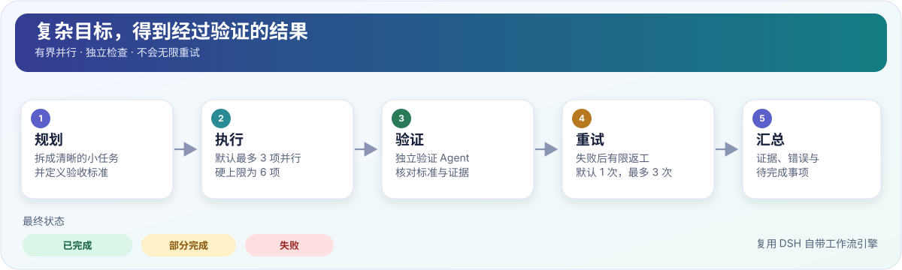

# Grok Workflow for DSH

<p align="center">
  <strong>给 DSH 一个目标，让它规划任务、并行执行、独立验证，并如实汇报结果。</strong>
  <br />
  <a href="README.md">English</a> · <a href="README.zh-CN.md">简体中文</a>
</p>

<p align="center">
  <a href="https://github.com/free6589/dsh-grok-workflow/actions/workflows/ci.yml"></a>
  
  
  <a href="LICENSE"></a>
</p>

**Grok Workflow for DSH** 是 [DeepSeek Harness（DSH）](https://github.com/deepseek-ai/deepseek-harness) 的插件。它增加了一个工具 `grok_workflow`，帮助 DSH 把复杂目标拆成清晰、可检查的步骤。

你不需要编写工作流脚本。安装插件、重启 DSH 配置，然后让模型调用 `grok_workflow` 即可。



## 一条命令安装

**开始之前：** 需要 DSH **`0.2.1-rc.2`** 和 Node.js **22 或更高版本**。你的 DSH 配置需要包含 workflow 和 subagent 服务；标准 base/headless 组合已提供这些服务。

如果还没有配置，请先从 headless 模板创建配置，**再安装插件**：

```sh
dsh --profile grok-workflow-dev --from-default-profile headless --dump-config
```

然后安装插件：

```sh
dsh plugin --profile grok-workflow-dev add github:free6589/dsh-grok-workflow
```

这条命令会从 GitHub 安装插件，并把它添加到指定配置中。如果你的配置名称不同，把 `grok-workflow-dev` 换成自己的配置名称。不要在 `plugin add` 之后运行 `--from-default-profile`：它会覆盖配置，并删除刚安装的插件。

然后重启该配置，让 DSH 加载插件：

```sh
dsh --profile grok-workflow-dev
```

可以用 `dsh --version` 和 `node --version` 检查版本。本项目**没有发布到 npm**，上面的安装命令直接使用 GitHub。

## 启用与验证

`dsh plugin add` 会添加 bundle 行。重启后确认它已组合进配置：

```sh
dsh --profile grok-workflow-dev --dump-config | grep -A4 'grok-workflow'
```

正常输出应包含 `id: grok-workflow` 和 `name: dsh-grok-workflow`。

## 试用一下

启动 DSH 后，对模型说：

> 使用 `grok_workflow` 检查当前代码仓库，找出两个互相独立的问题，根据现有文件逐一验证，并总结仍然不确定的部分。不要修改文件。

就这样。模型可以自动制定计划。第一次使用通常不需要再做其他配置。

## 它是怎么工作的？

这个工作流的设计目标，是避免把 Agent 自己说的“完成了”直接当成真正完成。

| 步骤 | 做什么 |
|---|---|
| **1. 规划** | 把目标拆成较小的任务，并明确每项验收标准。 |
| **2. 执行** | 并行运行互相独立的任务，默认最多 3 个并发执行者。 |
| **3. 验证** | 由新的验证 Agent 根据验收标准和证据检查结果。 |
| **4. 重试** | 验证失败时有限返工，不会无限循环。 |
| **5. 汇总** | 清楚报告结果、证据、错误和未完成事项。 |

### 最终状态怎么看？

- **`completed`（完成）**：所有计划任务都通过验证，且没有使用降级计划。
- **`partial`（部分完成）**：部分工作已通过，但仍有未完成或不确定的事项。
- **`failed`（失败）**：没有任务成功通过验证，或者执行中途失败，无法生成有效报告。

报告会列出每项任务的状态、证据、尝试次数、错误和不确定因素，方便你看清哪些内容真的经过了验证。

## 默认限制

| 设置 | 默认值 | 硬上限 |
|---|---:|---:|
| 并行执行任务数 | 3 | 6 |
| 每项任务重试次数 | 1 | 3 |
| 每次运行的任务数 | 6 | 12 |
| 同时运行的工作流 | 2 | 4 |

插件复用 DSH 自带的工作流引擎和子 Agent，不会另造一套 Agent 引擎，也不会绕过 DSH 的审批和工具权限规则。

**需要注意：** 当前版本的并行任务共享 DSH 会话的工作目录。若任务会修改文件，请给每个任务分配不重叠的文件范围，或者将 `maxConcurrency` 设为 `1`。独立验证能提高可靠性，但不等于数学意义上的正确性证明。

## 配置、禁用与卸载

配置写在 profile 的 `cordis.patch.yml`（或 `--patch` 覆盖层）的 bundle 行中：

```yaml
- id: grok-workflow
  config:
    toolName: grok_workflow
    maxConcurrency: 3
    maxRetries: 1
    maxTasks: 6
    timeoutMs: 1800000
    maxActiveRuns: 2
    # subagentProvider: spawn
```

| 配置项 | 默认值 | 硬上限 | 含义 |
|---|---:|---:|---|
| `toolName` | `grok_workflow` | 模式 `^[a-z][a-z0-9_]{1,40}$` | 模型看到的工具名 |
| `maxConcurrency` | `3` | `6` | 每次运行同时执行的子 Agent 数 |
| `maxRetries` | `1` | `3` | 每个任务首次执行后的重试次数 |
| `maxTasks` | `6` | `12` | caller 或 planner 生成的最大任务数 |
| `timeoutMs` | `1800000` | `86400000` | 单次运行总时限 |
| `maxActiveRuns` | `2` | `4` | 同一插件实例中并发的 `grok_workflow` 调用数 |
| `subagentProvider` | 引擎默认（`spawn`） | 字符串 | 可选的 subagent provider 覆盖 |

只禁用这一行：

```yaml
- id: grok-workflow
  disabled: true
```

卸载插件：

```sh
dsh plugin --profile grok-workflow-dev remove dsh-grok-workflow
```

禁用或移除后不会注册工具和提示词段落，普通 DSH 会话不受影响。

## 遇到问题怎么办？

- **找不到工具：** 重启 DSH 配置，并确认它包含 workflow 引擎和 subagent provider。
- **DSH 版本不一致：** 当前只验证过 DSH `0.2.1-rc.2`。
- **想调整并发数或重试次数：** 查看[配置说明](#配置禁用与卸载)和[故障排查](docs/LOCAL-TESTING.md#troubleshooting)。
- **想了解技术设计：** 查看[架构说明](docs/ARCHITECTURE.md)和[验收清单](docs/ACCEPTANCE.md)。
- **发现 Bug：** [提交 Issue](https://github.com/free6589/dsh-grok-workflow/issues)。

## 版本与更新日志

当前仓库的 package 版本号是 `0.1.0`，`v0.1.0` 的 GitHub Release 和标签已经发布。可以通过标签固定安装版本或回退，例如：

```sh
dsh plugin --profile grok-workflow-dev add github:free6589/dsh-grok-workflow#v0.1.0
```

请只使用 GitHub 上真实存在的版本标签。`v0.1.0` 标签已经发布；上面的未固定版本命令跟随 `main`，不会固定到某个发布版本。版本规则和回退步骤见[更新日志](CHANGELOG.md)与[版本发布指南](docs/RELEASING.md)。

## 测试与开发

克隆仓库后执行：

```sh
npm ci
npm run ci
```

测试套件包含 **6 个文件、56 个确定性测试**，不会调用在线模型；覆盖生成的工作流、并发/重试边界、脱敏、生命周期和真实 DSH Loader 组合。GitHub Actions 还会检查提交的 `lib/` 产物和 `npm pack --dry-run`。真实 DSH/模型验收结果记录在[验证日志](docs/knowledge/VALIDATION.md)中。

## 安全与兼容性

- 当前仅验证 DSH **`0.2.1-rc.2`** 和 Node.js **22 或更高版本**；包中声明了精确的 DSH peer 版本（`@deepseek-ai/cordis` 使用兼容的 `~4.0.5` 范围）。这是外部 DSH bundle，不修改 DSH 核心。
- 不会绕过 DSH 的审批、沙箱或工具权限策略。子 Agent 不能递归调用 `grok_workflow`；它们继承的其他工具仍受 DSH 自身策略约束。
- 子 Agent 继承父会话可用的工具和权限；当前没有只读能力模式。验证器提示会要求它不要修改文件，但这不是强制沙箱保证。
- 脱敏是尽力而为：不要把凭据放进 objective、任务文本或日志；报告不能保证子 Agent 从未接触过敏感信息。
- 并行任务共享会话工作目录。写文件多的任务应使用互不重叠的文件范围，或设置 `maxConcurrency: 1`；独立验证是证据检查，不是数学证明。
- 本项目未发布 npm 包，请从 GitHub 仓库安装。

## 已知限制

- 不支持暂停/恢复、journaling 或跨进程恢复；取消是协作式的。
- 不支持后台任务模式；调用在前台运行。
- 不支持任务依赖图；任务必须彼此独立。
- 不支持按任务选择模型/provider；子 Agent 继承父级路由。
- 没有自定义 Web UI；结果显示在 DSH 的通用工具卡片中。
- 并行任务共享会话工作目录；写文件多的任务应使用互不重叠的范围或 `maxConcurrency: 1`。
- 完整列表见[架构限制](docs/ARCHITECTURE.md#known-architecture-limits-mvp)。

## 更多文档

- [本机安装与故障排查](docs/LOCAL-TESTING.md)
- [架构说明](docs/ARCHITECTURE.md)
- [验收清单](docs/ACCEPTANCE.md)
- [Issue 监控脚本（可选）](docs/ISSUE-WATCHER.md)
- [更新日志](CHANGELOG.md)
- [版本管理与发布指南](docs/RELEASING.md)
- [项目状态与交接记录](docs/knowledge/STATE.md)

## 许可证

[MIT](LICENSE)
